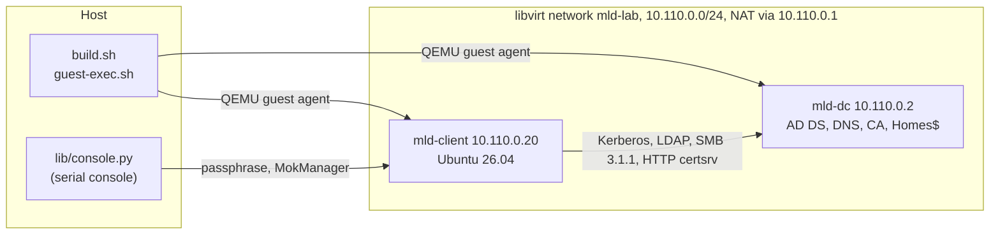
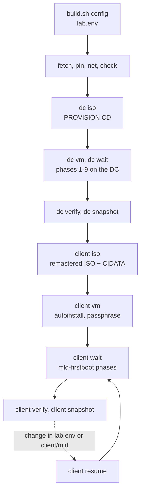

# Managed Linux desktop lab

Integration of an Ubuntu 26.04 desktop into an Active Directory environment, as a reproducible libvirt lab. `build.sh` builds a Windows Server 2025 DC (AD DS, DNS, AD CS, file share `Homes$`) and the client, then tests the integration end to end. The same code makes an install image for real hardware.

Integration points on the client:

- Domain join by offline domain join (`djoin.exe` blob, Samba `net offlinejoin`), no join password. Kerberos AES256 only.
- AD login through sssd, home directory on the DC over CIFS (`sec=krb5`).
- Certificates from the enterprise CA with TPM keys: autoenrollment (certmonger) and manual enrollment (certsrv, DCOM).
- Group Policy through `samba-gpupdate`, ADMX templates in the central store.
- Full disk encryption (LUKS2), unlocked by TPM2 (PCR 7), signed UKI per kernel through shim and MOK.
- Firefox and Chrome with AD CA trust and Kerberos policy, Microsoft 365 apps, snx-rs VPN with the machine certificate, automatic updates.

A client rebuild from scratch takes about one hour.

## Quick start

You need a Linux host with libvirt/KVM, about 20 GB of RAM (the two VMs take 14 GB), up to 110 GB of disk space (VM disks of 60 and 40 GB, thin-provisioned, plus 9 GB of ISO files), and the host tools in [Prerequisites](#prerequisites). The first full build takes about 1.5 to 2.5 hours, most of it unattended.

```sh
./build.sh setup
```

`setup` asks for the settings and passwords that `lab.env` does not have (Enter takes the default or generates a password), then does everything else without a stop: it downloads and checks the ISO files, makes the libvirt network and pool, checks the host, builds and tests the DC, builds and tests the client, and takes a snapshot of each VM. If it stops, for example after a network problem, run it again: it continues where it stopped.

Then open the client in virt-manager and log in as `alice` with `LAB_USER_PW` from `lab.env`. The step-by-step version with the expected output is [Build the lab](#build-the-lab).

## The lab

| VM | OS | Firmware | Address | Role |
|---|---|---|---|---|
| `mld-dc` | Windows Server 2025 evaluation | SeaBIOS | 10.110.0.2 | AD DS forest `mld.contoso.com`, DNS, NTP, enterprise CA, share `Homes$` |
| `mld-client` | Ubuntu 26.04 LTS desktop (GNOME or KDE Plasma) | OVMF, Secure Boot with Microsoft keys, swtpm TPM 2.0 | 10.110.0.20 (DHCP by MAC) | Device under test |



The DC uses BIOS on purpose. It is not under test, and Windows Setup from a UEFI CD stops at "Press any key to boot from CD".

## What the client has

| Area | Features | Procedures |
|---|---|---|
| Boot and disk | Secure Boot (shim → grub → kernel, or a signed UKI per kernel). Full disk encryption: ESP and `/boot` plain, the rest LUKS2 → LVM → root. Keyslots: passphrase, recovery key, optional TPM2 (PCR 7) and FIDO2. | [boot-and-disk.md](docs/boot-and-disk.md) |
| Identity and files | AD join without a join password: offline domain join with a `djoin.exe` blob, as for Windows clients (Samba `net offlinejoin`). AD login through sssd, only for `LinuxUsers`. Home directory `\\dc1\Homes$\<user>` over CIFS with `sec=krb5` (`CIFS_HOME=1`), or local. | [identity-and-pki.md](docs/identity-and-pki.md) |
| Certificates | Machine and user certificates from the AD CA with TPM keys: autoenrollment like Windows (certmonger), or manual (certsrv, DCOM). The AD CA certificates are trusted by the system, Chrome and Firefox, with renewal. | [identity-and-pki.md](docs/identity-and-pki.md) |
| Desktop and apps | GNOME or KDE Plasma (`CLIENT_DE`). Firefox (Mozilla deb) and Chrome without the default-browser prompt and telemetry. Microsoft 365 apps as Chrome app windows: menu entries, pins and desktop icons from the first login. | [desktop-and-apps.md](docs/desktop-and-apps.md) |
| Management | Group Policy through `samba-gpupdate` (GPO `MLD Linux Clients`, ADMX in the central store). Daily automatic updates, reboot at night when nobody is logged in. Boot and login screen with a logo. snx-rs Check Point VPN client, with the machine certificate as second factor. | [management.md](docs/management.md) |
| Real hardware | `./build.sh client hw-iso`: one install image for a USB stick. No passwords on the stick; the installer asks for them. Offline join blobs per device, signing key made on the device, `mld-firstboot secure` for the recovery key, MOK and TPM2. | [real-hardware.md](docs/real-hardware.md) |

Design decisions, the current status, open items and a comparison with the Red Hat and Canonical AD documentation are in [docs/overview.md](docs/overview.md). The limits that are known today are in [Known limits](#known-limits).

## How the build works



`build.sh` drives everything. The guests provision themselves. The host talks to them only through the QEMU guest agent (`guest-exec.sh dc|client`).

- **DC.** `dc iso` renders `dc/autounattend.xml.tmpl` and `config.ps1` from `lab.env` into the `PROVISION` CD. `dc/provision/run.ps1` then runs the phases across reboots: 1 AD DS, 2 DNS, time, OUs, users and the join account, 3 share `Homes$`, 4 WinRM and RDP, 5 domain facts for the host, 6 AD CS, 7 certificate templates, 8 Linux GPO, 9 ADMX central store. The state is in `C:\build\phase`. The result is `C:\build\DONE` or `C:\build\FAILED`. `dc resume` runs the phases again after a change.
- **Client.** `client iso` remasters the Ubuntu live-server ISO so it boots with `autoinstall ds=nocloud`, and renders the `CIDATA` seed CD. The autoinstall sets up LVM on LUKS and the packages, then copies `client/mld/` to `/etc/mld` (list: `client/mld/install.list`). The VM stays off after the install. `client start` boots it with the serial console attached and types the passphrase at the prompt (`lib/console.py`). On first boot, `mld-firstboot.service` runs one phase file per topic in `client/mld/` (`boot ad cert home apps desktop gpo vpn update brand`). The result is `/var/lib/mld/DONE` or `/var/lib/mld/FAILED`. `client resume` copies the changed files and settings to the client and runs the first boot again.
- **Media.** The ISO files are in `data/media`, the VM disks in `data/pool`. `checksums.sha256` pins the Ubuntu ISO, using Canonical's published `SHA256SUMS`. Microsoft and virtio-win publish no ISO checksum, so `./build.sh pin` records their sums at first download (trust on first use).

## Repository layout

| Path | Content |
|---|---|
| `build.sh`, `lib/` | The build script and its parts: settings, host checks, DC, client, tests |
| `env.example` | All settings with defaults and help. `build.sh config` writes `lab.env` from it |
| `dc/` | Windows unattended setup and the DC phases (`dc/provision/0N-*.ps1`) |
| `client/user-data.tmpl` | Ubuntu autoinstall |
| `client/mld/<topic>/` | Everything that goes to `/etc/mld` on the client, one folder per topic with its `phase.sh` |
| `docs/` | Topic procedures and [overview.md](docs/overview.md): design, status, open items |

## Procedures

These procedures use ASD-STE100 Simplified Technical English. The topic procedures are in `docs/` (see [What the client has](#what-the-client-has)).

### Prerequisites

- Host tools: `virsh`, `virt-install`, `virt-xml`, `genisoimage`, `xorriso`, `openssl`, `python3`, `curl`, `swtpm`, `magick` (ImageMagick), OVMF (`/usr/share/OVMF/OVMF_CODE_4M.secboot.fd`).
- Optional host tool: `sshpass` for the login test.
- Your user account is a member of the `libvirt` group.
- The VM disks and ISO files are in `data/` in the repo (`DATA_DIR` in `lab.env`). `.gitignore` excludes `data/`.
- The `libvirt-qemu` user must be able to enter each parent directory of `data/` and `.stage/`.
  If `./build.sh check` shows `BAD libvirt-qemu cannot enter`, run the `setfacl` command that the check shows.

NOTE: `/run/media/$USER` is on tmpfs. The ACL on this directory is lost when the host reboots. Then run the `setfacl` command again.

### Build the lab

1. In a terminal, run `./build.sh config`.
   The script asks for each setting that `lab.env` does not have. It shows the default in brackets.
2. For each password, type a lab password two times, or push Enter to generate one.
   Windows password complexity applies to `ADMIN_PW`, `DSRM_PW`, `LAB_USER_PW` and `JOIN_PW`.
   The script writes the answers to `lab.env` (mode 600) and shows the values that it took.
3. Run `./build.sh fetch`.
4. If the script shows `NO-SUM` for the Windows or virtio-win ISO, run `./build.sh pin`.
5. Commit `checksums.sha256`.
6. Run `./build.sh net`.
7. Run `./build.sh check`.
8. If the check shows `MISSING`, `BAD-SUM` or `BAD`, correct the problem before you continue.
9. Run `./build.sh dc iso`.
10. Run `./build.sh dc vm`.
11. Run `./build.sh dc wait`.
    The DC build takes approximately 30 to 60 minutes.
12. Run `./build.sh dc verify`.
13. Make sure that all lines show `ok`.
14. Run `./build.sh dc snapshot`.
15. Run `./build.sh client iso`.
16. Run `./build.sh client vm`.
    The install takes approximately 15 to 40 minutes.
    Then the script starts the VM and types the passphrase.
17. Run `./build.sh client wait`.
18. Run `./build.sh client verify`.
19. Make sure that all lines show `ok`.
    The script moves the recovery key to `.stage/recovery-key`.
20. Keep `.stage/recovery-key` in a safe location.
21. Run `./build.sh client snapshot`.

`./build.sh setup` does steps 1 to 21 in one run, and `./build.sh all` does steps 7 to 21. Both continue after an interruption: a VM that has the snapshot `post-build` is not built again.

NOTE: Each command asks for missing settings first, for example after an update adds a setting to `env.example`. Without a terminal, the script takes the defaults, generates the passwords, and shows the values that it took. To see all settings, run `./build.sh config`.

### Remove a VM

**CAUTION:** THIS PROCEDURE DELETES THE VM DISK, NVRAM, TPM STATE AND ALL SNAPSHOTS. YOU CANNOT UNDO IT.

1. To remove the client, run `./build.sh client destroy`.
2. To remove the DC, run `./build.sh dc destroy`.
3. Type the VM name when the script asks for it.

NOTE: Do not use `virsh undefine --remove-all-storage`. It also deletes the attached ISO files.

### Log in as an AD user

1. Open the client console in virt-manager.
2. On the GDM login screen (GNOME), click "Not listed?". The SDDM login screen (KDE) asks for the user name immediately.
3. Type the AD user name, for example `alice`, and the `LAB_USER_PW` password.
4. Open a terminal and run `findmnt /home/alice`.
5. If `CIFS_HOME=1`, make sure that the file system type is `cifs`.
6. Log out.
7. If `CIFS_HOME=1`, make sure that the CIFS mount is not there any more.

### Apply changed settings to a built client

1. Change the setting in `lab.env`, or change the files in `client/mld/`.
2. Run `./build.sh client resume`.
3. Run `./build.sh client wait`.
   Do not restart the client before the script shows `DONE`.
4. Run `./build.sh client verify`.
5. Make sure that all lines show `ok`. A Chrome Kerberos line shows `open` (see [Known limits](#known-limits)).

NOTE: `client resume` does not change the desktop (`CLIENT_DE`) or the disk layout. For these settings, build the client again.

NOTE: Each `build.sh` copy reads the `lab.env` file in its own directory. For a second client VM, use a second work tree with its own `lab.env` (other `CLIENT_VM`, `CLIENT_HOSTNAME`, `CLIENT_MAC`, `CLIENT_IP`).

### Set the local admin password again

1. Run `./build.sh client set-admin-password`.
2. Make sure that the script shows `labadmin P` (password set).

NOTE: cloud-init deletes the password of the installer user at the first boot. `mld-firstboot` sets it again from `CLIENT_ADMIN_PW`, and `client verify` shows `ok local admin has a password`.

### Start the client after a shutdown

1. Run `./build.sh client start`.
   The script starts the VM and types the passphrase on the serial console.

### Go back to the snapshot

1. Run `./build.sh dc revert`.
   The script sets the DC clock to the host UTC time. Kerberos rejects a clock skew of more than 5 minutes.
2. Run `./build.sh client revert`.

### Monitor a build

- DC phase: `./build.sh dc phase`
- DC log: `./build.sh dc log 100`
- Client first-boot log: `./build.sh client log 100`
- Client serial console during boot: `.stage/client-console.log`
- Screen: `./build.sh dc screenshot`, `./build.sh client screenshot`

## Known limits

- With `UKI=0`, `/boot` and the initrd are not signed. PCR 7 does not detect a changed initrd. `UKI=1` closes this gap.
- PCR 7 alone does not protect against a replaced root partition with the same UUID. A TPM2 PIN or a signed PCR 11 policy closes this gap. The lab has neither.
- A db or dbx update changes PCR 7. Then the TPM2 unlock fails. To seal again, run `mld-firstboot enroll-tpm2` with `PASSWORD` set, on a UKI boot.
- `lab.env`, `.stage/dc-provision.iso` and `.stage/cidata.iso` contain the lab passwords. `.gitignore` excludes them. The client deletes its copies after first boot.
- `$HOME` on CIFS is the most probable source of desktop problems (dconf, gvfs, flatpak). `/etc/profile.d/mld-xdg-cache.sh` moves `XDG_CACHE_HOME` to local disk. Finding the remaining problems is a purpose of the lab.
- If TPM2 and FIDO2 are both enrolled, `/etc/crypttab` has both options. Not tested: systemd-cryptsetup can use only one of them in this case.
- Microsoft can change the build behind the Windows Server download link. Then the pinned checksum does not match, and `fetch` stops.
- Windows Server 2025 DCs send a KPASSWD reply that MIT Kerberos rejects ("Message stream modified", [realmd/adcli#40](https://gitlab.freedesktop.org/realmd/adcli/-/issues/40)). Because of this, the join uses Samba offline domain join (no kpasswd), not adcli. A password change from Linux (`passwd`, kpasswd) and the sssd machine password renewal also fail against this DC.
- Google Chrome 157 does no Kerberos (Negotiate) login: Chrome writes "Unable to create AuthHandler. Status: net::ERR_UNSUPPORTED_AUTH_SCHEME Challenge: Negotiate". The result is the same with the GPO allowlist, with the allowlist as a command-line flag, with `--no-sandbox`, with `AuthSchemes` set to `negotiate`, and with an explicit `--gssapi-library-name`. The cause is not known. Firefox does Kerberos with the same ticket. `client verify` shows the Chrome result as `open`, not as `FAIL`.
- A shim update that changes the SBAT level changes PCR 7. After the automatic reboot at night, the client then waits for the passphrase.

## License

Apache License 2.0, see [LICENSE](LICENSE). Copyright 2026 Armin Felder. [NOTICE](NOTICE) lists the third-party files in this repository (APT signing keys of Mozilla, Google and snx-rs) and the software that the build downloads.
