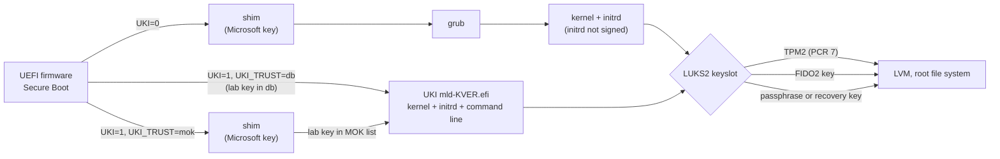

# Boot and disk encryption

Secure Boot, LUKS2 keyslots (TPM2, FIDO2) and the signed unified kernel image (UKI). The text is for Ubuntu. Fedora differences are in [Fedora differences](#fedora-differences).

These procedures use ASD-STE100 Simplified Technical English. The prerequisites and the build procedure are in [README.md](../README.md).

PCR 7 records the Secure Boot state and the certificate that verified the boot loader. Thus the TPM2 keyslot opens only on the boot path that it was sealed on.

## Use TPM2 unlock

1. Before you run `./build.sh client iso`, set `ENROLL_TPM2=1` in `lab.env`.
2. Build the client (see [Build the lab](../README.md#build-the-lab), steps 15 to 19).
3. Run `./build.sh client reboot-test`.
4. Make sure that the script shows `unlocked without the passphrase`.

NOTE: The TPM2 keyslot is bound to PCR 7 (Secure Boot state). A change of the Secure Boot keys or the shim makes the TPM2 unlock fail. Then the boot asks for the passphrase.

## Use a signed UKI (optional)

Secure Boot is always on. A unified kernel image (UKI) is optional.
With `UKI=1` and `UKI_TRUST=db` (default), the firmware starts a signed UKI directly, without shim and grub.
The kernel, the initrd and the kernel command line are in the signed UKI, so Secure Boot also covers them.
For a UKI that does not change the firmware keys, see [Use a signed UKI through shim and MOK](#use-a-signed-uki-through-shim-and-mok-optional).

1. Install `virt-fw-vars` on the host (package `python3-virt-firmware`, or `pip install virt-firmware`).
2. In `lab.env`, set `UKI=1`.
3. Optional: to also unlock with the TPM, set `ENROLL_TPM2=1` in `lab.env`.
4. Run `./build.sh check`.
5. Make sure that the check shows `ok virt-fw-vars (UKI=1)`.
6. Build the client (see [Build the lab](../README.md#build-the-lab), steps 15 to 19).
7. Make sure that `./build.sh client verify` shows `ok booted from signed UKI`.
8. If `ENROLL_TPM2=1`, run `./build.sh client reboot-test`.
9. Make sure that the script shows `unlocked without the passphrase`.

NOTE: `build.sh` makes a lab signing key in `.stage/sb`. The client also has a copy in `/etc/mld/sb`, so it can sign a new UKI after a kernel update. A production client must not keep the signing key.

NOTE: Each installed kernel has its own UKI (`\EFI\Linux\mld-<kernel>.efi`) and its own boot entry (`MLD UKI <kernel>`, or `MLD UKI (shim) <kernel>` with `UKI_TRUST=mok`). The newest kernel is first in the boot order. When apt installs a kernel, `/etc/kernel/postinst.d/zz-mld-uki` makes its UKI and boot entry. When apt removes a kernel, `/etc/kernel/postrm.d/zz-mld-uki` removes them.

## Start an older kernel (UKI)

1. On the client, run `sudo efibootmgr`.
2. Find the number of the entry `MLD UKI <kernel>` (or `MLD UKI (shim) <kernel>`) of the older kernel, for example `0005`.
3. Run `sudo efibootmgr --bootnext 0005`.
4. Restart the client.
5. Make sure that `uname -r` shows the older kernel.

NOTE: `BootNext` applies to one boot only. The boot after it starts the newest kernel again. The firmware menu (`Esc` at the logo) is not a good alternative: the boot timeout is 0 seconds.

NOTE: All UKIs have the same signature. Thus PCR 7, and with it the TPM2 unlock, is the same for each kernel.

NOTE: The shim and grub boot entry stays as the last entry. If the UKI does not boot, the firmware starts grub with Secure Boot. Then the TPM2 unlock fails, because PCR 7 is different, and the boot asks for the passphrase.

## Use a signed UKI through shim and MOK (optional)

With `UKI_TRUST=mok`, the firmware keys stay as delivered: Microsoft keys only.
shim starts the UKI and checks its signature against the MOK list.
This is the procedure for devices where you cannot change the firmware db.
The MOK enrollment is the same as on a real device: the OS sends the request, and MokManager asks for a confirmation at the next boot.
In the lab, `lib/console.py` types the confirmation and the MOK password on the serial console.

1. In `lab.env`, set `UKI=1` and `UKI_TRUST=mok`.
2. In `lab.env`, set `MOK_PASSWORD`. Use only ASCII characters.
3. Optional: to also unlock with the TPM, set `ENROLL_TPM2=1` in `lab.env`.
4. Run `./build.sh check`.
5. Make sure that the check shows `ok mokutil (UKI_TRUST=mok: MOK password hash)`.
6. Build the client (see [Build the lab](../README.md#build-the-lab), steps 15 to 17).
   The first boot uses shim and grub. If `ENROLL_TPM2=1`, the TPM2 enrollment waits for the UKI boot.
7. Run `./build.sh client mok-enroll`.
   The script requests the MOK, confirms it in MokManager, adds a boot entry `MLD UKI (shim) <kernel>` for each kernel and boots the newest UKI.
   If `ENROLL_TPM2=1`, the script then enrolls the TPM2 keyslot.
8. Run `./build.sh client verify`.
9. Make sure that the script shows `ok lab certificate in MOK`, `ok lab certificate not in db` and `ok boot entry shim + UKI`.
10. If `ENROLL_TPM2=1`, run `./build.sh client reboot-test` and `./build.sh client fallback-test`.
11. Make sure that the scripts show `unlocked without the passphrase` and `TPM2 refused on the shim + grub path`.

`./build.sh all` does steps 7 to 11 when `UKI=1` and `UKI_TRUST=mok`.

NOTE: `client fallback-test` boots the plain shim and grub entry one time (`BootNext`). The TPM must not unlock this path, because PCR 7 is different. The test also applies to `UKI_TRUST=db`.

NOTE: If `client mok-enroll` stops with `boot went on without MokManager`, read `.stage/client-console.log`. MokManager waits only 10 seconds for a key.

## Fedora differences

`CLIENT_DISTRO=fedora` gives the same boot chain, keyslots and UKI options. These values differ:

| | Ubuntu | Fedora |
|---|---|---|
| Installer | autoinstall (subiquity) | kickstart `client/ks.cfg.tmpl` (Anaconda) |
| Partitions | ESP 1 GB, `/boot`, LUKS2 PV, LVM root | same: ESP 1 GB, `/boot` ext4, LUKS2 PV, LVM `root` (xfs) |
| Shim | `\EFI\ubuntu\shimx64.efi` | `\EFI\fedora\shimx64.efi` |
| initrd | `/boot/initrd.img-<kernel>` | `/boot/initramfs-<kernel>.img` |
| Kernel command line | `/etc/default/grub` and `update-grub` | `grubby --update-kernel=ALL` (BLS entries) |
| UKI hook | `/etc/kernel/postinst.d/zz-mld-uki`, `postrm.d/zz-mld-uki` | `/etc/kernel/install.d/60-mld-uki.install` (kernel-install `add`, `remove`) |

NOTE: The UKI text above also applies to Fedora, except that `dnf` installs the kernel and `kernel-install` runs the hook.

NOTE: The `systemd-networkd` DNS mask of the Ubuntu client is not part of the Fedora build. The Fedora DNS setting is in `client/mld/ad/phase.sh` (`dns_configure_fedora`).

## Use FIDO2 unlock

1. Connect the FIDO2 key to the host.
2. Run `lsusb` and find the vendor and product IDs of the key.
3. In `lab.env`, set `FIDO2_HOSTDEV` to `vendor:product`, for example `1050:0407`.
4. If the key has a PIN, set `FIDO2_PIN` in `lab.env`.
5. Run `./build.sh client enroll-fido2`.
6. When the key blinks, touch the key.
7. Run `./build.sh client reboot-test`.
8. When the key blinks, touch the key.
9. Make sure that the script shows `unlocked without the passphrase`.

NOTE: The key is attached with `startupPolicy='optional'`. The VM also starts when the key is not connected. Then the boot asks for the passphrase.
