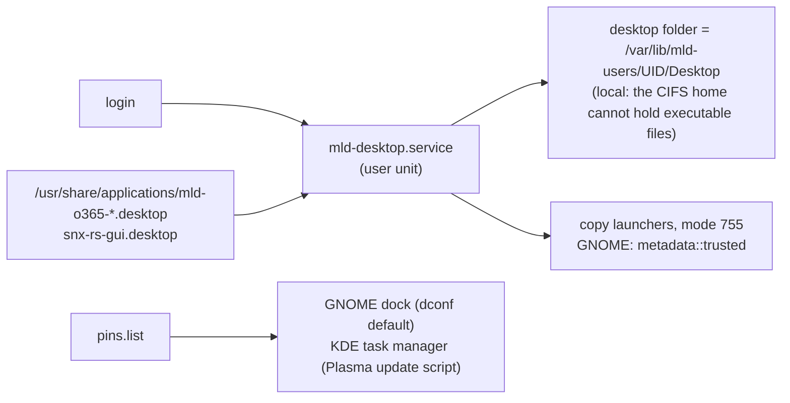

# Desktop and apps

The desktop (GNOME or KDE Plasma) and the Microsoft 365 apps. Fedora differences are in [Fedora differences](#fedora-differences).

These procedures use ASD-STE100 Simplified Technical English. The prerequisites and the build procedure are in [README.md](../README.md).

What the client puts on the desktop at each login (user unit `mld-desktop.service`):

## Use KDE Plasma instead of GNOME

1. In `lab.env`, set `CLIENT_DE=kde`.
2. Build the client (see [Build the lab](../README.md#build-the-lab), steps 15 to 19). On a built client, first remove the client VM (see [Remove a VM](../README.md#remove-a-vm)).
3. Run `./build.sh client verify`.
4. Make sure that the script shows `ok desktop kde (display manager sddm.service)` and `ok task manager pins (Plasma update script)`.

NOTE: `./build.sh client resume` does not change the desktop. If `CLIENT_DE` does not agree with the desktop on the client, the first boot stops with "build the client again".

NOTE: On Ubuntu, the KDE login screen uses the SDDM theme Breeze and asks for the user name (no user list). The package `kde-plasma-desktop` also installs `budgie-sddm-theme`. This theme shows a white login screen under Plasma, so the first boot removes it.

NOTE: Plasma runs the pin script one time for each user, at the next login. If a user changes the task manager after that, the change stays.

## Fedora differences

| | Ubuntu | Fedora |
|---|---|---|
| Desktop package group | `ubuntu-desktop-minimal`, `kde-plasma-desktop` | `workstation-product-environment`, `kde-desktop-environment` |
| GNOME | Dock and desktop icons (`mld-desktop` user unit) | Stock GNOME: no desktop icons, no `mld-desktop`. Pins go to the dash (dconf default `favorite-apps`). The Microsoft 365 launchers are in the app grid. |
| KDE login screen | SDDM (Breeze theme, no user list) | Plasma Login Manager (`plasmalogin.service`, `/etc/plasmalogin.conf.d/90-mld.conf` for the background) |
| Firefox | Mozilla deb (repository pin) | Fedora package |
| Chrome | Google deb repository | Repository `google-chrome` of `fedora-workstation-repositories`, enabled by the first boot. Key: `google-linux-signing.asc` (imported with `rpm --import`) |
| Firefox pin | `firefox.desktop` | `org.mozilla.firefox.desktop` (`@firefox` in `pins.list`) |
| dconf profile `user` | Written by the first boot | Stock file of the `dconf` package. The first boot does not change it. |

NOTE: The Plasma Login Manager package has no setting for the user list that corresponds to SDDM `MaximumUid`. AD login on this screen is a manual check: `client verify` shows a warning, not `ok`.

To test the AD login on Fedora KDE:

1. On the login screen, log in as an AD user.
2. If the login does not work, use the fallback: SDDM on Fedora KDE (packages `sddm`, `sddm-breeze`, `kde-settings-sddm`).

NOTE: The SDDM fallback is not in the code yet. It also needs `plasmalogin.service` disabled.

NOTE: For Fedora KDE, step 4 of "Use KDE Plasma instead of GNOME" shows `ok desktop kde (display manager plasmalogin.service)`.

## Use the Microsoft 365 apps

1. Log in to the client desktop as an AD user.
2. Make sure that the desktop shows the icons of the Microsoft 365 apps.
3. Make sure that the dock (GNOME) or the task manager (KDE) shows Outlook, Teams, Word, Excel, PowerPoint and OneDrive.
4. Start an app, for example Outlook, and sign in with the Microsoft 365 account.

NOTE: Each app opens in a Chrome app window (`google-chrome-stable --app=<URL>`). The lab has no Microsoft 365 tenant, so the sign-in is not tested.

NOTE: The dock pins are a default. If a user changes the dock, the user setting stays.

NOTE: Files that the user puts on the desktop stay on the device. They do not go to the CIFS home.

NOTE: To change the list of apps, edit `client/mld/desktop/o365-apps.list` and run `./build.sh client resume`. Each icon has a SHA-256 sum in the list.
