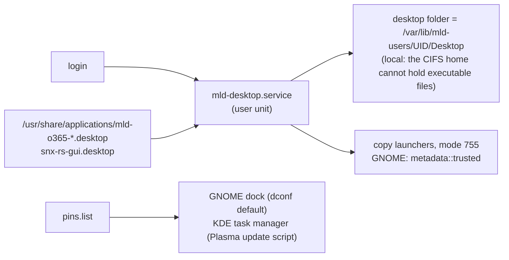

# Desktop and apps

The desktop (GNOME or KDE Plasma) and the Microsoft 365 apps.

These procedures use ASD-STE100 Simplified Technical English. The prerequisites and the build procedure are in [README.md](../README.md).

What the client puts on the desktop at each login (user unit `mld-desktop.service`):

## Use KDE Plasma instead of GNOME

1. In `lab.env`, set `CLIENT_DE=kde`.
2. Build the client (see [Build the lab](../README.md#build-the-lab), steps 15 to 19). On a built client, first remove the client VM (see [Remove a VM](../README.md#remove-a-vm)).
3. Run `./build.sh client verify`.
4. Make sure that the script shows `ok desktop kde (display manager sddm.service)` and `ok task manager pins (Plasma update script)`.

NOTE: `./build.sh client resume` does not change the desktop. If `CLIENT_DE` does not agree with the desktop on the client, the first boot stops with "build the client again".

NOTE: The KDE login screen uses the SDDM theme Breeze and asks for the user name (no user list). The package `kde-plasma-desktop` also installs `budgie-sddm-theme`, which shows a white login screen under Plasma. The first boot removes it.

NOTE: Plasma runs the pin script one time for each user, at the next login. If a user changes the task manager after that, the change stays.

## Use the Microsoft 365 apps

1. Log in to the client desktop as an AD user.
2. Make sure that the desktop shows the icons of the Microsoft 365 apps.
3. Make sure that the dock (GNOME) or the task manager (KDE) shows Outlook, Teams, Word, Excel, PowerPoint and OneDrive.
4. Start an app, for example Outlook, and sign in with the Microsoft 365 account.

NOTE: Each app opens in a Chrome app window (`google-chrome-stable --app=<URL>`). The lab has no Microsoft 365 tenant, so the sign-in is not tested.

NOTE: The dock pins are a default. If a user changes the dock, the user setting stays.

NOTE: Files that the user puts on the desktop stay on the device. They do not go to the CIFS home.

NOTE: To change the list of apps, edit `client/mld/desktop/o365-apps.list` and run `./build.sh client resume`. Each icon has a SHA-256 sum in the list.
