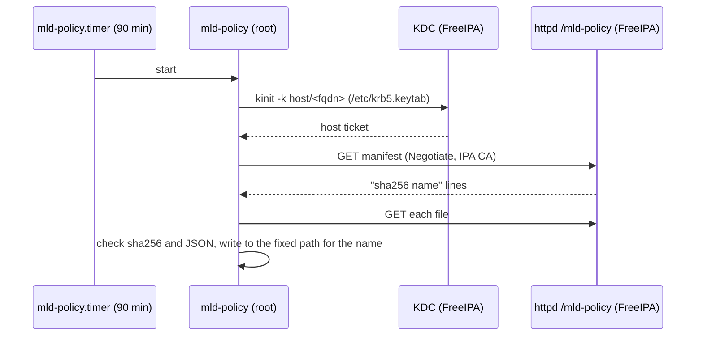

# FreeIPA instead of Active Directory (IDP=freeipa)

With `IDP=freeipa` in `lab.env`, the `dc` role is a FreeIPA server on Fedora 45 instead of the Windows DC. The lab then has no Microsoft software and uses no Microsoft protocols. The client features are the same where an equivalent exists. `IDP=windows` stays the default.

These procedures use ASD-STE100 Simplified Technical English. The prerequisites and the build procedure are in [README.md](../README.md).

| Function | `IDP=windows` | `IDP=freeipa` |
|---|---|---|
| Directory, Kerberos, DNS | AD DS on Windows Server 2025 | FreeIPA (389 DS, MIT KDC, BIND) on Fedora 45 |
| Join | offline domain join (`djoin.exe` blob, `net offlinejoin`) | `ipa-client-install` with a one-time password per host |
| User login | sssd `id_provider = ad` | sssd `id_provider = ipa`, access by the HBAC rule `mld-linux-login` |
| Home directory | CIFS `sec=krb5` (pam_mount), `/home/<user>` | NFSv4 `sec=krb5p` (autofs map `auto.home` from IPA), `/home/mld/<user>` |
| Certificates | AD CS templates, autoenrollment (`mld-autoenroll`) | IPA CA: certmonger CA `IPA` (machine), profile `mldUserCert` (user) |
| Browser policy | GPO `MLD Linux Clients` (`samba-gpupdate`) | files from `https://<server>/mld-policy/` (`mld-policy`) |
| Time | the DC | `pool.ntp.org` |
| Microsoft 365 launchers | yes (`O365_APPS=1`) | no (`O365_APPS=0`) |

How the client gets its browser policy:

## Server

The server VM has the name `DC_VM` and the address `DC_IP` from `lab.env`, as the Windows DC. `dc vm` installs Fedora 45 from the netinstall ISO with `ipa/ks.cfg.tmpl`. Then `mld-ipa-provision.service` runs the phases in `ipa/provision/`:

| Phase | File | Result |
|---|---|---|
| 1 | `01-install.sh` | `ipa-server-install` with DNS and CA, realm `REALM`, forwarder `NET_GW`, ID range from 200000 |
| 2 | `02-directory.sh` | users `LAB_USERS`, group `IDM_GROUP`, host group, automember rule, HBAC rule `mld-linux-login` (`allow_all` disabled) |
| 3 | `03-nfs.sh` | `/export/home/<user>`, export `sec=krb5p`, service `nfs/<server>`, automount keys |
| 4 | `04-pki.sh` | certificate profile `mldUserCert`, CA ACL `mld-users` |
| 5 | `05-policy.sh` | policy files from `ipa/policy/`, manifest, Kerberos-only endpoint `/mld-policy` |

The state is in `/var/lib/mld-ipa` (`phase`, `DONE`, `FAILED`, `provision.log`). The phases can run again: `./build.sh dc resume [PHASE]`.

NOTE: `IPA_DM_PW` is the Directory Manager password (LDAP root). FreeIPA refuses passwords with less than 8 characters: `dc iso` stops before the build.

## Build the lab with FreeIPA

1. In `lab.env`, set `IDP=freeipa`.
2. Set `CLIENT_DISTRO` to `fedora` or `ubuntu`.
3. Do the procedure [Build the lab](../README.md#build-the-lab).
   The script asks for `IPA_DM_PW`. It does not ask for the Windows settings.
4. After `./build.sh dc verify`, make sure that all lines show `ok`.
   The server build takes approximately 5 minutes after the install.
5. After `./build.sh client verify`, make sure that all lines show `ok`.
   A Chrome Kerberos line shows `open` (see [Known limits](../README.md#known-limits)).

NOTE: For a lab with both identity servers, use a second work tree with its own `lab.env` (other `DC_VM`, `DC_IP`, `DOMAIN`, `CLIENT_VM`, `CLIENT_HOSTNAME`, `CLIENT_MAC`, `CLIENT_IP`).

NOTE: One client has one identity server. To change `IDP` of a built client, remove the client and build it again.

## Log in and use the NFS home directory

1. Log in to the client as `alice` with the `LAB_USER_PW` password.
2. Open a terminal and run `findmnt /home/mld/alice`.
3. Make sure that the file system type is `nfs4` and that the options include `sec=krb5p`.
4. Run `klist`.
5. Make sure that the ticket cache is `FILE:/tmp/krb5cc_<uid>`.

NOTE: autofs mounts the home directory at the first access and unmounts it when it is not used. `rpc.gssd` reads the login ticket of the user from `/tmp/krb5cc_<uid>`. A KCM or keyring ticket cache does not work with the NFS mount: `/etc/krb5.conf.d/0-mld-ccache` sets the file cache.

NOTE: The home directory is the same on each client. The TPM keys and the certmonger state of a user stay in `/var/lib/mld-users/<uid>` on each device, as with the CIFS home.

## Change the browser policy

The policy files are in `ipa/policy/`: `chrome-kerberos.json` and `firefox.json`. `@@DOMAIN@@` becomes the lab domain on the server. The client uses only these names:

| Name on the server | File on the client |
|---|---|
| `chrome-<name>.json` | `/etc/opt/chrome/policies/managed/mld-policy-<name>.json` |
| `firefox.json` | `/etc/firefox/policies/policies.json` |

1. Change or add a file in `ipa/policy/`.
2. Run `./build.sh dc policy`.
3. Run `./build.sh dc wait`.
4. On the client, run `systemctl start mld-policy` as root, or wait for the timer (90 min).
5. Run `./build.sh client verify`.
6. Make sure that the line `browser policy from the IPA server` shows `ok`.

NOTE: The server sends file names only. A name that is not in the table above has no effect on the client. If the download, the sha256 check or the JSON check fails, the client keeps the files of the last good pull.

NOTE: On Fedora, `mld-policy` removes the Firefox security device `p11-kit-trust` from `firefox.json`. The Fedora Firefox package reads the system certificate store, and `ipa-client-install` adds the IPA CA to this store. On Ubuntu, the device gets the Ubuntu path of `p11-kit-trust.so`.

NOTE: `mld-policy` also writes the IPA CA certificates from `/etc/ipa/ca.crt` to `/etc/opt/chrome/policies/managed/mld-ca.json`. Chrome on Linux does not read the system certificate store.

## Certificates from the IPA CA

With `PKI_ENROLL=ipa` (the default with `IDP=freeipa`), the client gets one machine certificate and one certificate for each user. Each key is in a TPM token, as with AD CS.

| | Machine | User |
|---|---|---|
| certmonger request | `mld-ipa-machine` (system) | `mld-ipa-user` (session, `getcert list -s`) |
| certmonger CA | `IPA` (from `ipa-client-install`, host keytab) | `mld-ipa-user` (`ipa-submit -K -T mldUserCert`, login ticket) |
| Subject | `CN=<fqdn>,O=<REALM>` | `CN=<user>,O=<REALM>` |
| TPM token | `mld-machine` in `/etc/tpm2_pkcs11` | `mld-user` in `/var/lib/mld-users/<uid>/.tpm2_pkcs11` |

The CA ACLs on the server control which accounts get a certificate. The client does no template search.

1. Run `./build.sh client autoenroll-test`.
2. Make sure that the machine line and the user line show `ok`.
3. To test a renewal, run `./build.sh client autoenroll-test renew`.
4. Make sure that all 4 lines show `ok`, also `token mld-machine: 1 certificate` and `token mld-user: 1 certificate`.

NOTE: A renewal adds the new certificate to the token and keeps the old one, with the same key ID. snx-rs uses all certificates of the slot. The post-save command `/usr/local/libexec/mld-cert-prune` removes the older certificates after each renewal (`mld-autoenroll prune`).

**CAUTION:** Do not use `pkcs11-tool --delete-object --id` to remove a certificate. Two certificates have the same ID, and the tool can delete the new one.

## Known limits

- Both client distros are built and tested with `IDP=freeipa` (Fedora 45 and Ubuntu 26.04, 2026-11-18). A login of the same user on two clients at the same time is not tested.
- `client hw-iso` is for `IDP=windows` only. A FreeIPA join of a real device needs a one-time password for each host.
- Google Chrome does no Kerberos login (`ERR_UNSUPPORTED_AUTH_SCHEME`), as with AD. Firefox does Kerberos to the policy endpoint.
- The FreeIPA server shows an AVC denial at boot: `rpcbind_t name_bind unreserved_port_t udp_socket`. The server has no `mld` SELinux module. NFS works.
- The design and the spike results are in [docs/superpowers/specs/2026-11-18-freeipa-design.md](superpowers/specs/2026-11-18-freeipa-design.md).
