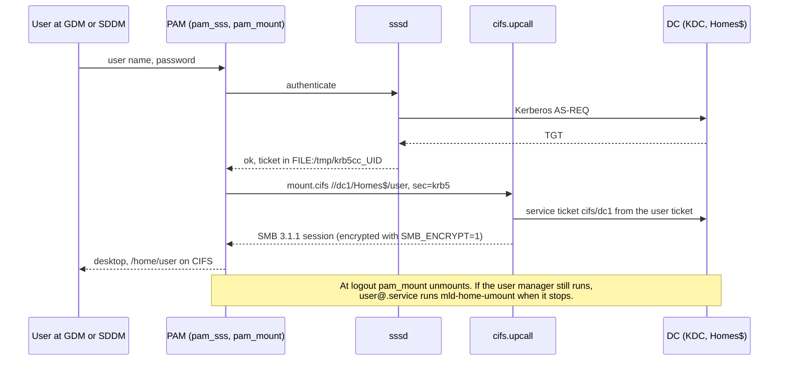
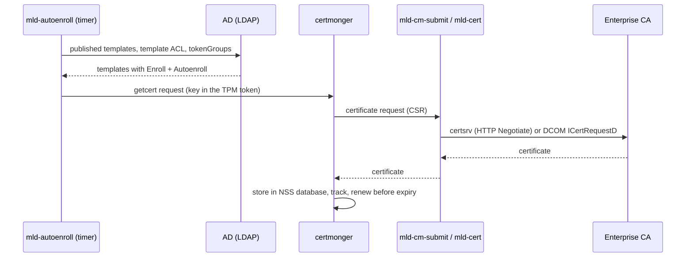

# Identity, home directory and certificates

AD certificates with TPM keys (autoenrollment and manual), and the local or CIFS home directory.

These procedures use ASD-STE100 Simplified Technical English. The prerequisites and the build procedure are in [README.md](../README.md).

How a login gets the CIFS home directory (`CIFS_HOME=1`):

How autoenrollment gets a certificate:

## Fedora differences

`CLIENT_DISTRO=fedora` gives the same identity, home and certificate features. These values differ:

| | Ubuntu | Fedora |
|---|---|---|
| PAM | `pam-auth-update`, `common-auth`, `common-session` | authselect profile `mld` (custom, based on `sssd`); `pam_mount` is in `/etc/pam.d/system-auth` and `password-auth` |
| PKCS#11 module | `/usr/lib/x86_64-linux-gnu/pkcs11/libtpm2_pkcs11.so` | `/usr/lib64/pkcs11/libtpm2_pkcs11.so` |
| AD CA certificates | `/usr/local/share/ca-certificates/mld/`, `update-ca-certificates` | flat files `/etc/pki/ca-trust/source/anchors/mld-*.crt`, `update-ca-trust extract` |
| SELinux | not used | enforcing; file contexts, one boolean (`use_samba_home_dirs`) and the module `mld` in `client/mld/selinux/` |

NOTE: On Fedora, the CA anchors are flat files with the prefix `mld-`. The p11-kit trust loader may not read subdirectories of `anchors/`. A live check of `trust list` is open.

NOTE: `client verify` checks `getenforce` = `Enforcing` and the AVC denials since boot. `mld-avc-report` hides only the lines that match `client/mld/selinux/avc-ignore.list` (one regex and one bug URL for each line). The list is empty. Do not make SELinux permissive to clear a denial: add a file context, a boolean or a rule in `client/mld/selinux/mld.te`.

## Join a computer to AD (offline domain join)

The client joins AD as a Windows client does with `djoin.exe`: the DC makes the computer account in `OU=Computers,OU=Linux` and a blob with its password. The client applies the blob (`net offlinejoin requestodj`). No join password goes to the client.

`./build.sh client iso` makes the blob for `CLIENT_HOSTNAME` and puts it on the CIDATA CD. The first boot applies it, makes `/etc/krb5.keytab` and deletes the blob.

To join a device that has no blob:

1. Run `./build.sh client odj NAME`. NAME is the host name of the device (1 to 15 characters).
   On a production network, a Windows administrator can run `djoin.exe /provision /domain DOMAIN /machine NAME /machineou "OU=Computers,OU=Linux,..." /savefile NAME.txt` instead.
2. Copy `.stage/odj/NAME.txt` to the device.
3. On the device, run `sudo mld-firstboot join NAME.txt`.
4. Run `journalctl -fu mld-firstboot` and make sure that the first boot shows `=== DONE ===`.
5. Delete the copy of the blob.

**CAUTION:** The blob contains the password of the computer account. Keep it like a password until the device has used it.

**CAUTION:** If the computer account exists, `client odj NAME` stops. `client odj --replace NAME` deletes the account in `OU=Computers,OU=Linux` and makes a new one: a device that still uses the old account loses its join. Windows blocks the reuse of an account that an other user made (KB5020276), so the script does not use `djoin /reuse`.

## Certificate autoenrollment

The client enrolls certificates as a Windows client does. A template applies when all of these are true:

- The CA publishes the template.
- The template has schema version 2 or higher and the autoenrollment flag.
- The template ACL gives Enroll and Autoenroll to the computer, the user or one of their groups.

Phase 7 makes two such templates: `MLD-LinuxComputer` (Domain Computers) and `MLD-LinuxUser` (`LINUX_GROUP`).
certmonger keeps the certificates and renews them before they expire. Each key is in a TPM token (`tpm2-pkcs11`).

| | Machine | User |
|---|---|---|
| Command | `mld-autoenroll machine` (root) | `mld-autoenroll user` (AD user) |
| Schedule | `mld-autoenroll.timer`: 5 min after boot, then every 8 h | `mld-autoenroll-user.timer`: 1 min after login, then every 8 h |
| certmonger | system service | session instance (`mld-certmonger-user.service`) |
| TPM token | `mld-machine` in `/etc/tpm2_pkcs11` | `mld-user` in `/var/lib/mld-users/<uid>/.tpm2_pkcs11` (local, per device) |
| Certificate | NSS database `/etc/mld/pki/nssdb` | NSS database `~/.pki/nssdb` |

1. Run `./build.sh client autoenroll-test`.
2. Make sure that the 2 lines (machine and user) show `ok`.

To examine the requests, run `getcert list` (machine, as root) or `getcert list -s` (user).
To renew a certificate now, run `getcert resubmit -i mld-MLD-LinuxComputer`.

NOTE: A Windows administrator controls the enrollment with the usual tools: template permissions and the CA template list. To stop the enrollment for the Linux clients, remove the Autoenroll permission. At the next run, `mld-autoenroll` stops the tracking.

## Get certificates with a TPM key (manual)

The DC has an enterprise CA (`CA_NAME`) with web enrollment (`http://dc1/certsrv`).
The client makes each private key in the TPM (`tpm2-openssl`). The key never leaves the TPM.
`mld-cert` sends only the certificate request, through certsrv (`web`) or through DCOM (`dcom`, `ICertRequestD`).

| Certificate | Template | Kerberos ticket | Files |
|---|---|---|---|
| Machine | `Machine` | machine account (keytab) | `/etc/mld/pki/machine.{tss,crt}` |
| User | `User` | the user's login ticket | `/var/lib/mld-users/<uid>/mld-pki/user.{tss,crt}` (local, per device) |

1. In `lab.env`, set `PKI_ENROLL` to `web` or `dcom`. To get no machine certificate at first boot, set `none`.
2. On an existing DC, run `./build.sh dc resume`, then `./build.sh dc wait`.
3. Run `./build.sh dc verify`.
4. Make sure that the CA lines show `ok`.
5. On an existing client, run `./build.sh client resume`, then `./build.sh client wait`.
6. Run `./build.sh client pki-test`.
7. Make sure that the 4 lines (machine and user, web and dcom) show `ok`.

To get a user certificate on the client, log in as the AD user and run `mld-cert user web` or `mld-cert user dcom`.
To examine a certificate, run `mld-cert check user` or, as root, `mld-cert check machine`.

NOTE: The `User` template puts the e-mail address into the certificate. Phase 6 sets `mail` for the lab users. An AD user without `mail` gets no user certificate.

NOTE: A TPM key works only in the TPM that made it. The home directory can be on the DC (CIFS) and go to each device. Thus the TPM files of a user stay in `/var/lib/mld-users/<uid>` on the device. Each device has its own user key and user certificate.

NOTE: The members of `LINUX_GROUP` can use `/dev/tpmrm0` (udev rule), so that they can make their own TPM keys.

## Use a local home directory

1. In `lab.env`, set `CIFS_HOME=0`.
2. Run `./build.sh client resume`.
3. Run `./build.sh client wait`.
4. Run `./build.sh client verify`.
5. Make sure that the script shows `ok local home (CIFS_HOME=0)`.

NOTE: To go back to the CIFS home directory, set `CIFS_HOME=1` and do steps 2 to 4 again. A new client build also uses the value in `lab.env`.
