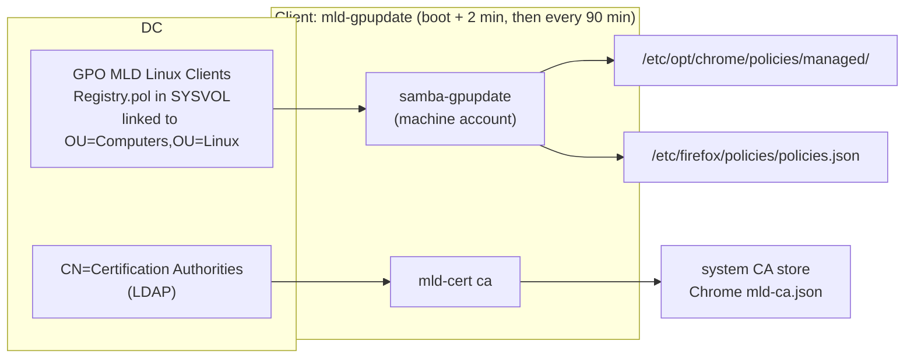
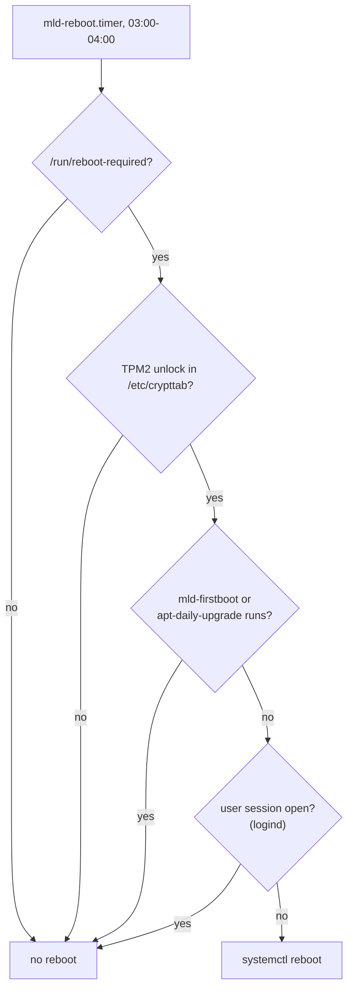

# Management

Group Policy, automatic updates, the boot and login screen, and the VPN client.

These procedures use ASD-STE100 Simplified Technical English. The prerequisites and the build procedure are in [README.md](../README.md).



## Change the Group Policy for the Linux clients

1. On the DC, open the Group Policy Management console.
2. Edit the GPO `MLD Linux Clients`. Use only Computer Configuration settings.
3. On the client, run `sudo mld-gpupdate --rsop` to show the settings that apply.
4. Run `sudo mld-gpupdate --force` to apply the settings now. Else the timer applies them in 90 minutes or less.

NOTE: `samba-gpupdate` applies all GPOs that apply to the computer, also the Default Domain Policy. Do not link the setting "Certificate Services Client - Auto-Enrollment" to the Linux OU: the Linux autoenrollment is `mld-autoenroll`.

NOTE: DC phase 9 puts the ADMX templates for Samba (Unix settings, smb.conf), GNOME, Firefox and Chrome in the central store (`SYSVOL\domain\Policies\PolicyDefinitions`), with the Windows templates. Then the GPMC editor shows these settings by name. The Samba and Mozilla files have a pinned SHA-256 sum. Google publishes only the newest Chrome templates, so these have no fixed sum: to update them, delete `chrome.admx` in the central store and run `./build.sh dc resume`.

## Examine the automatic updates

The client installs updates each day with unattended-upgrades. The sources are the Ubuntu release, `-security` and `-updates`, and the third-party repositories of Firefox (`packages.mozilla.org`), Chrome (`dl.google.com`) and snx-rs (`ancwrd1.github.io`). The settings are in `/etc/apt/apt.conf.d/52mld-unattended-upgrades` (`client/mld/update/`).

1. Run `./build.sh client verify`.
2. Make sure that the script shows `ok automatic updates` and `ok update sources`.
3. To see when the next update starts, run `systemctl list-timers apt-daily-upgrade.timer` on the client.
4. To see the installed updates, read `/var/log/unattended-upgrades/unattended-upgrades.log` on the client.
5. To see the reboot decisions, run `journalctl -u mld-reboot.service` on the client.



NOTE: `mld-reboot.timer` starts between 03:00 and 04:00. It restarts the client only when all of these conditions are true:

- An update requires a reboot (`/run/reboot-required`).
- `/etc/crypttab` has TPM2 unlock. Without TPM2, the boot stops at the passphrase prompt.
- `mld-firstboot` and `apt-daily-upgrade` do not run.
- No user session is open (logind, also ssh sessions).

NOTE: The unattended-upgrades setting `Automatic-Reboot` stays off. Its user check reads only utmp.

NOTE: Unused kernels are removed. The kernel hook then removes their UKI and boot entry.

**CAUTION:** A shim update that changes the SBAT level also changes PCR 7. After the reboot, the TPM2 unlock fails and the client waits for the passphrase. Type the passphrase, then seal again (see the known limits in [README.md](../README.md#known-limits)).

## Change the boot and login screen

The boot screen (Plymouth theme `mld`) and the KDE login screen (SDDM Breeze) show a logo on a background color. The default logo is `client/mld/brand/logo.svg`.

1. Make a logo file: PNG or SVG, light colors on a dark background, approximately 480 x 140 pixels.
2. In `lab.env`, set `BRAND_LOGO` to the path of the logo file.
3. In `lab.env`, set `BRAND_BG` to the background color, for example `#1e3a5f`.
4. Run `./build.sh client resume`.
5. Run `./build.sh client wait`.
   Do not restart the client before the script shows `DONE`: the client makes the initrd and the UKIs again.
6. Run `./build.sh client verify`.
7. Make sure that the script shows `ok Plymouth theme mld`.
8. If `CLIENT_DE=kde`, make sure that the script shows `ok SDDM theme Breeze, MLD background`.
9. Run `./build.sh client reboot-test` and look at the client screen in virt-manager.

NOTE: `build.sh` converts the logo with ImageMagick (`magick`) into `.stage/brand/logo.png` and a 1920 x 1080 background `.stage/brand/background.png`. Each file must be 64 KiB or less.

NOTE: The GNOME login screen (GDM) does not show the logo.

## Remove or add the VPN client (snx-rs)

1. In `lab.env`, set `SNX_RS=0` to remove snx-rs, or `SNX_RS=1` to install it.
2. Run `./build.sh client resume`.
3. Run `./build.sh client wait`.
4. Run `./build.sh client verify`.
5. If `SNX_RS=1`, make sure that the script shows `ok snx-rs installed` and `ok snx-rs service: active`.
6. If `SNX_RS=0`, make sure that the script shows `ok snx-rs not installed (SNX_RS=0)`.

NOTE: The users make their VPN profile in `snx-rs-gui`.

## Use the machine certificate as second VPN factor (snx-rs)

The machine key is in the TPM token `mld-machine` in `/etc/tpm2_pkcs11`. Only root can read this store. The snx-rs service runs as root and opens the token through PKCS#11. The PIN of the token is `MACHINE_TOKEN_PIN` (default `mld-machine`). It is the same on all clients and is not a secret, so it can be in the user profile. Thus the connection does not ask for a PIN.

1. Make sure that `PKI_ENROLL` is not `none` and that `SNX_RS=1`.
2. Run `./build.sh client verify`.
3. Make sure that the script shows `ok machine cert over PKCS#11` and `ok machine key signs (no prompt)`.
4. In the VPN profile of the user (`snx-rs-gui`), set these values:

   ```
   cert-type=pkcs11
   cert-path=/usr/lib/x86_64-linux-gnu/pkcs11/libtpm2_pkcs11.so
   cert-password=<MACHINE_TOKEN_PIN>
   ```

5. Select a login type of the gateway that uses the user password. snx-rs then sends the machine certificate as the second factor.

NOTE: Do not set `cert-id`. Each device has its own key with its own ID, and the home directory with the profile goes to each device.

NOTE: If you change `MACHINE_TOKEN_PIN`, run `./build.sh client resume`. The first boot then changes the PIN of the token (`tpm2_ptool changepin`). Change the profiles of the users too.
