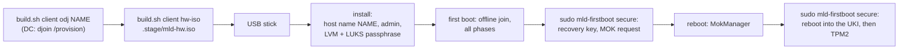

# Real hardware

`./build.sh client hw-iso` makes `.stage/mld-hw.iso`, an install image for a real PC or laptop. It installs the same client as the lab VM, with these differences:

| | Lab VM (`client iso`) | Real hardware (`client hw-iso`) |
|---|---|---|
| Install | Unattended | The installer asks for the host name, the admin user and password, and the disk with the LUKS passphrase |
| Secrets on the medium | Admin hash, LUKS passphrase, offline join blob | Only the offline join blobs (`/odj`) |
| AD join | Blob for `CLIENT_HOSTNAME` | Blob for the host name that you type (`/odj/NAME.txt`) |
| UKI signing key (`UKI_TRUST=mok`) | Lab key from the host (`.stage/sb`) | Made on the device at the first boot, never on the stick |
| Recovery key, MOK, TPM2 | `build.sh` from the host | `sudo mld-firstboot secure` on the device |
| Console | Serial console for `build.sh` | Screen only |

The device needs a wired network that reaches the DC (DNS and Kerberos to `DC_IP`), UEFI with Secure Boot (Microsoft keys), and a TPM 2.0 for `ENROLL_TPM2=1`.

These procedures use ASD-STE100 Simplified Technical English.

With `CLIENT_DISTRO=fedora`, the image is a Fedora 45 Everything netinstall ISO with a partial kickstart (`lib/hw-ks.py`): no storage, user and network sections, so Anaconda asks for them. The steps in "Install a device" differ only on the installer screens: see [Fedora differences](#fedora-differences).



## Make the install stick

1. For each device, select a host name: 1 to 15 characters, letters, digits and `-`.
2. Run `./build.sh client odj NAME1 NAME2 ...`.
   The DC makes a computer account in `OU=Computers,OU=Linux` for each name. The blobs go to `.stage/odj/`.
3. Run `./build.sh client hw-iso`.
4. Make sure that the script shows `mld-hw.iso ready` and the number of blobs.
5. Write `.stage/mld-hw.iso` to a USB stick, for example with `sudo dd if=.stage/mld-hw.iso of=/dev/sdX bs=4M conv=fsync`.

**WARNING:** `dd` erases the device that `of=` names. Make sure that `/dev/sdX` is the USB stick (`lsblk`).

**CAUTION:** The stick contains the offline join blobs. Each blob contains the password of one computer account. Keep the stick in a safe location. After the install of all devices, erase the stick.

## Install a device

**WARNING:** The install erases the disk that you select. Make a backup of the data on the device before you start.

1. Connect the device to the wired network.
2. Start the device from the USB stick (firmware boot menu, for example F12).
3. In the boot menu, select "Try or Install Ubuntu".
4. If the installer asks for a confirmation of the automatic install, confirm it.
5. On the identity screen, type the host name. Use the name of a blob (step 1 of "Make the install stick").
6. Type the admin user name and the admin password.
7. On the storage screen, select "Use an entire disk", "Set up this disk as an LVM group" and "Encrypt the LVM group with LUKS".
8. Type the LUKS passphrase two times.
9. Wait until the installer restarts the device. Remove the USB stick.
10. At the passphrase prompt, type the LUKS passphrase.
11. Wait until the first boot is complete (10 to 30 minutes). The KDE or GNOME login screen comes before the end.
12. Log in on a text console (Ctrl+Alt+F3) as the admin user.
13. Run `sudo journalctl -fu mld-firstboot` and wait for `=== DONE ===`.

NOTE: If the device had no blob, the first boot stops with `no offline join blob`. Make a blob (`./build.sh client odj NAME`), copy `.stage/odj/NAME.txt` to the device, and run `sudo mld-firstboot join NAME.txt`.

NOTE: The first boot checks that the root file system is on LUKS2. If you did not select the encryption in step 7, install the device again.

## Secure the device (recovery key, MOK, TPM2)

1. Log in as the admin user.
2. Run `sudo mld-firstboot secure`.
3. Type the LUKS passphrase.
4. Write down the recovery key that the command shows. Keep it in a safe location.
   The device does not keep a copy.
5. If `UKI_TRUST=mok`, type a one-time MOK password two times.
6. Restart the device.
7. In the blue MokManager screen, select "Enroll MOK", "Continue", "Yes".
8. Type the MOK password, then select "Reboot".
9. Type the LUKS passphrase at the prompt.
10. Log in as the admin user and run `sudo mld-firstboot secure` again.
11. If the command tells you to restart, restart the device and do step 10 again.
12. Make sure that the command shows `Nothing to do`.
13. Restart the device. Make sure that the boot does not ask for the passphrase (TPM2).

NOTE: The login message shows the open steps until `mld-firstboot secure` is complete.

NOTE: MokManager waits approximately 10 seconds for a key. If the device starts without MokManager, run `sudo mld-firstboot secure` again: it shows the pending request.

## Fedora differences

1. In the boot menu, select the first entry. Each entry of the patched menu carries `inst.ks=`.
2. In the installation summary, select the installation destination, and select "Encrypt my data". Type the LUKS passphrase.
3. Create the administrator user. The first user (UID 1000) is the admin of the client. A missing user stops the install.
4. Do steps 9 to 13 of "Install a device".
5. Do the procedure "Secure the device (recovery key, MOK, TPM2)".

NOTE: `client hw-iso` patches the boot menu in three places: the ISO `EFI/BOOT/grub.cfg`, `boot/grub2/grub.cfg` and the copy in `images/efiboot.img`. A USB stick boots the copy in the EFI image.

NOTE: The Fedora `hw-iso` supports only the Lorax layout, where the EFI image is an appended partition of the ISO. If the ISO has a path-based El Torito EFI layout, the script stops with an error. It does not make an image that ignores the kickstart.

NOTE: The Fedora `hw-iso` is checked by the render test only. It is not tested in Anaconda or on hardware.

## Test the stick in a VM

1. Run `./build.sh client odj lnx-hwtest`.
2. Run `./build.sh client hw-iso`.
3. Run this command (UEFI with Secure Boot and Microsoft keys, TPM 2.0, no guest agent):

   ```sh
   virt-install --connect qemu:///system --name mld-hwtest --memory 8192 --vcpus 4 \
     --cpu host-passthrough --osinfo ubuntu24.04 --network network=mld-lab \
     --disk pool=mld,size=40,bus=virtio,format=qcow2 --cdrom "$PWD/.stage/mld-hw.iso" \
     --boot loader=/usr/share/OVMF/OVMF_CODE_4M.secboot.fd,loader.readonly=yes,loader.type=pflash,loader.secure=yes,nvram.template=/usr/share/OVMF/OVMF_VARS_4M.ms.fd \
     --features smm.state=on --tpm backend.type=emulator,backend.version=2.0,model=tpm-crb
   ```

4. Do "Install a device" and "Secure the device" in the virt-manager console. Use the host name `lnx-hwtest`.
5. To remove the test VM, run `virsh -c qemu:///system destroy mld-hwtest`, then `virsh -c qemu:///system undefine mld-hwtest --nvram --tpm` and delete its disk in the pool.
